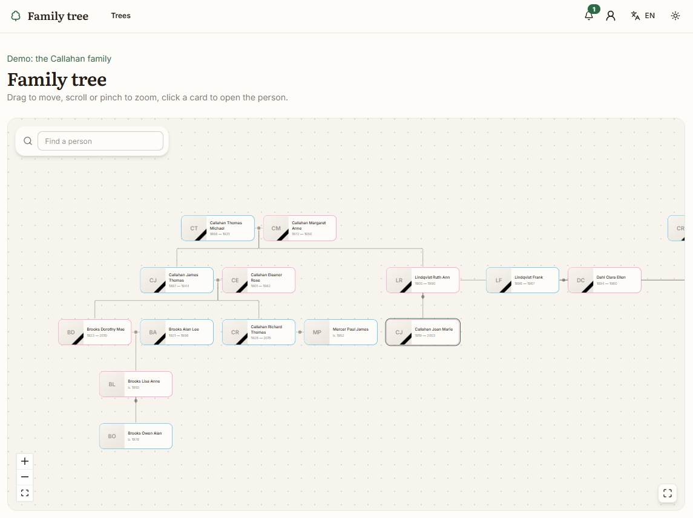
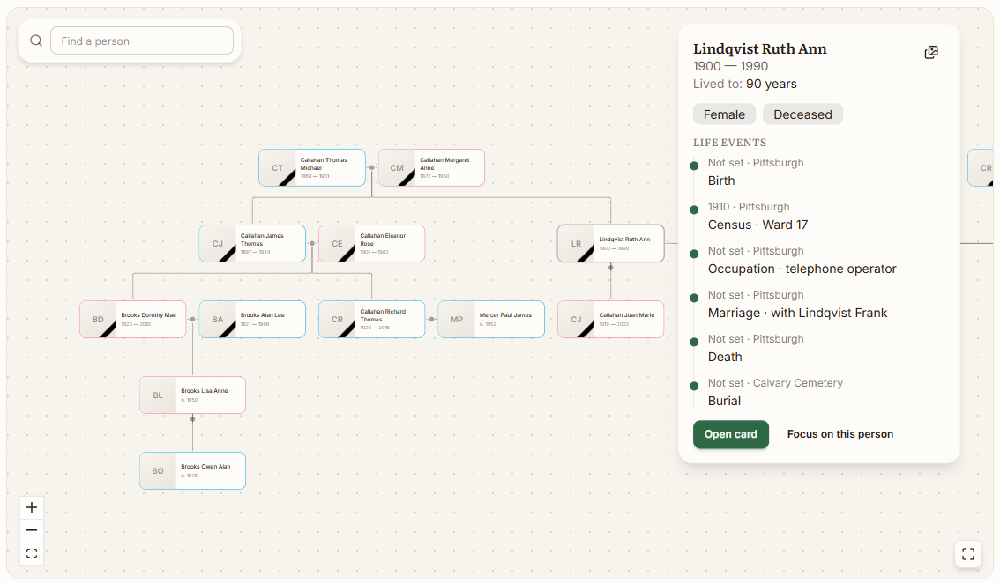
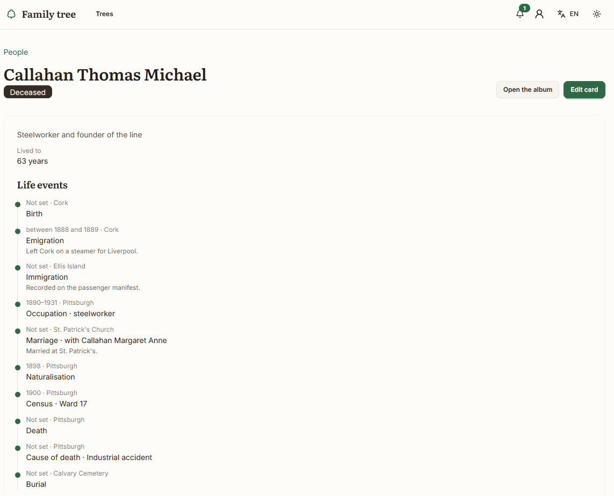

<p align="center">
  
</p>

# Familee — family tree

*Read this in another language: [Русский](README.ru.md)*

Familee is a place to keep your family's archive: the people, their marriages and children, the
events in their lives, the places they lived, the documents they came from and their photographs.
The tree is drawn as cards with a picture and a name. A click on a card opens it, and you can edit
it right there.

It runs on your own server. Everything stays in your database and your photo storage, nothing is
sent anywhere. The program uses the Postgres and Redis containers that are already running on your
server and does not start its own. You choose how to reach it: by the server's IP address and a
port, which is the default, or behind Traefik over HTTPS with a domain of your own.

The interface is in English by default and in Russian at `/ru`.

## What it does

- **People and families.** Each person has names, sex, birth and death dates, notes, other names
  (maiden, married, nickname) and life events with places. Dates can be as vague as the sources
  are: "about 1901" or "between 1915 and 1918". A family links partners and children, and the
  program will not let someone become their own ancestor.
- **The tree.** Cards with a photo and the years, drawn from top to bottom. A click opens a panel
  with the timeline, the notes and the photo album. Focus mode shows only the ancestors and
  descendants of one person. If you choose yourself in the tree, every card shows how it is related
  to you. Search brings the matching person into view. Living people show their current age, and
  people who have died show the age they reached.
- **Photographs.** Each person has an album with one main photo, which you can crop to the square
  the card shows. Events can have their own photos, and the gallery shows the photos of the whole
  tree.
- **Library.** Places, arranged inside each other (a city inside a region, a cemetery inside a
  city). Sources, such as a census page or a letter, and the citations that point from a person or
  an event to a source. Stories and notes. A search across all of it.
- **Birthdays.** The birthdays of the next two weeks from all your trees: in the bell in the top bar,
  on the home page, on the tree page, and on the members and people pages.
- **GEDCOM.** You can import a GEDCOM file of any version; the program reads the version from the
  file itself. You see a preview first and confirm before anything is written. A whole tree can be
  exported as GEDCOM 7.0.
- **Calendar.** The birthdays and the wedding days of a tree go out as an iCalendar feed. The
  address is on the tree page (it carries the tree's own key, so keep it to yourself); a calendar
  app on a phone subscribes to it beside everything else. Only dates with a full day are in the
  feed: an event known to the month would land on a day nobody recorded.
- **Access.** Each tree has its own members with roles: owner, administrator, co-author or viewer.
  Members come in through invitation links, and an administrator can hand out a password reset.
  The owner and administrators can see the change history and the devices each person is signed in
  on. An owner can delete a tree; an editor can move a person to the trash.
- **Trash.** Moving a person out of the tree puts them in its trash instead of destroying anything:
  the names, the events, the notes, the photographs and the unions stay, and the tree simply stops
  showing them. Anybody can be brought back at any time. The owner and the administrators can also
  delete them for good, and only then do the files go.

## Screenshots

<table>
  <tr>
    <td></td>
    <td></td>
    <td></td>
  </tr>
</table>

## Under the hood

The application is written in TypeScript on Next.js 16 with React 19. The data is in Postgres and is
read through Drizzle ORM. Sign-in is handled by better-auth, with sessions in Postgres and a cache
in Redis. The look is Tailwind CSS with daisyUI. Translations use next-intl. The tree is drawn with
@xyflow/react, and its layout is our own code. Photo previews are made with sharp.

## Server requirements

- Docker with the compose plugin.
- Postgres and Redis already running on the server. The Postgres server needs the `pgcrypto`,
  `pg_trgm` and `btree_gin` extensions available.
- The Postgres and Redis containers must be reachable by name from one Docker network, the one set
  as `DATA_NETWORK`. The application joins that network and connects to them by name.
- Optional: Traefik, if you want HTTPS on a domain. Without it the archive is reached by IP address.

## First run

**1. Database.** Connect to the shared Postgres as a superuser and create a role and a database for
Familee:

```sql
create role familee with login password 'pick_a_password';
create database familee owner familee;
```

Then connect to the `familee` database, still as a superuser, and enable the extensions. An ordinary
role is not allowed to do this:

```sql
create extension if not exists pgcrypto;
create extension if not exists pg_trgm;
create extension if not exists btree_gin;
```

You can also put the schema into a database you already have. Familee keeps all of its tables in
its own `familee` schema. In that case the role needs the `create` privilege on that database, and
`DATABASE_URL` points at the existing database name.

**2. Configuration.** Copy `.env.example` to `.env`, set its permissions to `600` and fill it in. You
must set `DATABASE_URL`, `REDIS_URL`, `DATA_NETWORK` and `BETTER_AUTH_SECRET`. For the secret, run
`openssl rand -base64 48`.

**3. How the archive is reached.** Choose one of two ways in `.env`:

- **By IP address (the default).** The application is published on `FAMILEE_PORT` of the server
  (3000 unless you change it), over plain HTTP. Set `BETTER_AUTH_URL=http://<server-ip>:<FAMILEE_PORT>`
  and nothing else. Plain HTTP is fine on a home network. For the internet, put an HTTPS proxy in
  front of the application.
- **Behind Traefik over HTTPS.** Set `FAMILEE_HOST` to your domain and `BETTER_AUTH_URL=https://<domain>`.
  Then enable the Traefik overlay in `.env`:

  ```bash
  COMPOSE_FILE=docker-compose.build.yml:docker-compose.traefik.yml
  ```

  Set `TRUSTED_PROXIES` to the subnet of the Traefik network, for example `192.168.90.0/24`. That lets
  the sign-in limit see the real address of each person instead of Traefik's. In the address-and-port
  mode leave it empty. The overlay connects the application to the proxy network `TRAEFIK_NETWORK`,
  adds the routing for your domain and removes the published port, so the archive is reachable only
  through Traefik. The entrypoint and the certificate resolver are set by `TRAEFIK_ENTRYPOINT` and
  `TRAEFIK_CERTRESOLVER`.

`BETTER_AUTH_URL` must be exactly the address your browser uses, with the scheme and the port. If it
differs, sign-in is refused as coming from another site.

**4. Build and start.**

```bash
docker compose build
docker compose up -d
docker compose logs -f app
```

To run the image published to the registry instead of building it on the server, set `COMPOSE_FILE=docker-compose.image.yml` and `FAMILEE_VERSION` (for example `0.2.3`) in `.env`, then run `docker compose pull` instead of `docker compose build`. The two compose files describe the same services.

The container brings the schema up to the version of the image before the server starts, so there is
no migration step of its own: an update is `pull` (or `build`) and `up -d`. Set `SKIP_MIGRATIONS=1`
to skip that. The `tools` service is a short-lived container that contains only `psql`, so you do
not need to install anything on the server; it stays for the demo seed and the smoke tests.

**5. Demo data (optional).** The demo shows the program with a made-up family, the Callahans of
Pittsburgh and Cleveland, over four generations. The family uses almost everything Familee can store:
immigration, a war death, two marriages, an annulment, a civil union, a stepson, an adopted son,
approximate dates, places, sources, citations and notes. It is a good way to look around before you
enter your own family.

You can create it in two ways. The first is the command line:

```bash
docker compose --profile tools run --rm tools seed
```

The second is a button on the profile page of an administrator, which asks for a confirmation first.
Either way, the tree with the address `demo` is replaced with the demo family, together with its
photos and files. Your own trees are not touched.

## Accounts and access

Public sign-up is closed. The first person opens `<BETTER_AUTH_URL>/setup` once and creates the
administrator account. After that the page does not exist any more. Everyone else gets an invitation
link from an owner or an administrator of a tree. The link works for 7 days and only once.

Roles are given per tree: owner, administrator, co-author and viewer. An invitation can give any role
except owner. Owners and administrators change roles and remove members on the members page. An
administrator cannot change another administrator or the owner, and nobody can change their own
access there. Each person sees the devices they are signed in on in their profile and can sign any
of them out.

`BETTER_AUTH_URL` must be the address your browser uses, with the port, for example
`http://192.168.0.10:3000` or `https://archive.example.com`. Otherwise the sign-in requests are
refused.

## Time zone

`APP_TIME_ZONE` is a time zone name such as `Europe/Berlin`. The default is `Asia/Vladivostok`. It sets
the time zone of the container, so every time on the screen is shown in it. The birthdays of the next
two weeks are also counted from the day in this zone.

## Database changes

The structure of the database is written in plain SQL, in the `db/migrations` folder. Each file adds
one change and is applied once, in order. The container applies the pending ones itself on start, so
an update is `pull` (or `build`) and `up -d`. The `tools` service can apply them by hand as well,
and it also loads the demo seed (`seed`) and runs the smoke tests (`test`).

## Languages

The interface is in English by default, and Russian is at `/ru`. To add a language, create one file,
`messages/<code>.json`. The easiest start is a copy of `messages/en.json`: translate the values and set
`locale.name` to the name of the language, written in that language. The languages are read from the
file names when the image is built, so there is nothing else to change.

You do not have to translate the whole file at once. A key that is missing or empty falls back to
English, so a half-translated language still works.

## License

Familee is released under the [MIT License](LICENSE). You may use, copy, change, fork and redistribute
it, including for commercial purposes, as long as the copyright and the permission notice stay in place.

## Backups

Your data is in two places: the `familee` schema in Postgres, and the `familee_media` volume with the
original photos and their previews. Back up both.

```bash
docker exec -t postgres pg_dump -U <superuser> --schema=familee --format=custom familee \
    > familee-$(date +%F).dump

docker run --rm -v familee_media:/data:ro -v "$PWD:/backup" alpine \
    tar czf /backup/familee-media-$(date +%F).tar.gz -C /data .
```

## Monitoring

The container's healthcheck uses `/api/health`, which only says that the process is up: it never
asks the database, so restarting Postgres does not make Docker restart a healthy application. For an
external monitor (Uptime Kuma, Gatus, a `curl` from cron), `/api/ready` answers 200 only when both
Postgres and Redis answer, and names the one that is down otherwise:

```bash
curl -fsS https://familee.example.com/api/ready
# {"status":"ready","checks":{"database":true,"redis":true},"time":"..."}
```

## What comes next

The main items still open are: checking the newest features in a browser, citations for families and
places, and checking how the tree lays out on a real family.
